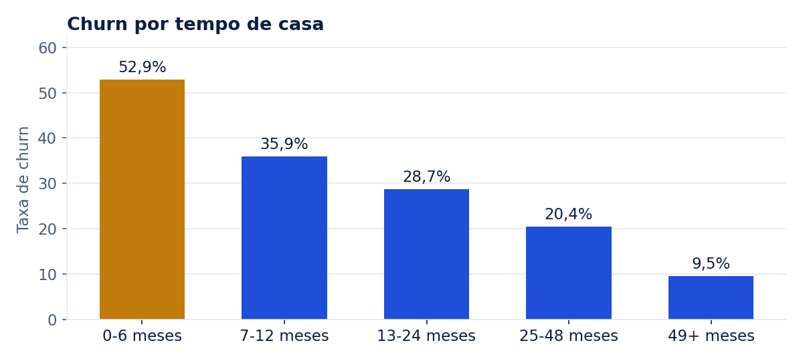
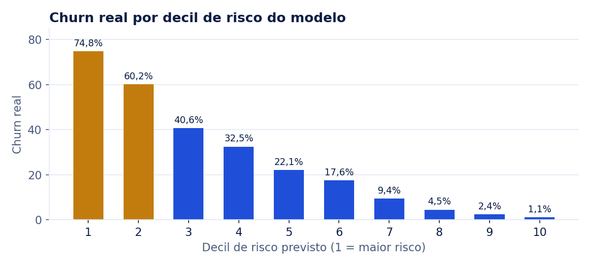

# Quem cancela e como antecipar o churn

    

**[Ver o dashboard interativo](https://bishoppython.github.io/telco-churn-diagnostico/)**

## 💡 Resumo do projeto

Uma operadora de telecom perde **26,5% dos clientes** e, com eles, **30,5% da receita mensal**. Diagnostiquei o perfil de quem cancela e construí um score de risco que coloca **51% dos cancelamentos nos 20% de clientes com maior risco**, com AUC de 0,84. Assim, a equipe de retenção sabe quem procurar primeiro.

## ❓ Problema de negócio / contexto

A operadora vê a base encolher, mas não sabe onde agir. A equipe de retenção tem capacidade limitada e liga para clientes sem critério. As perguntas são:

1. Qual é o perfil de quem cancela?
2. Quais fatores (contrato, tempo de casa, serviços, forma de pagamento) mais se associam ao churn?
3. Dá para prever quem está em risco e priorizar o contato?

## 📊 Dados utilizados

| Item | Detalhe |
|---|---|
| Fonte | [IBM Telco Customer Churn](https://github.com/IBM/telco-customer-churn-on-icp4d), base fictícia criada pela IBM para estudos |
| Volume | 7.043 clientes, 21 colunas, 1.869 cancelamentos |
| Variáveis | Perfil (idoso, parceiro, dependentes), serviços contratados, contrato, cobrança e churn |
| Moeda | Valores mensais em dólar, como na base original |

**Tratamentos necessários:**

- **`TotalCharges` em branco:** 11 clientes com 0 meses de casa ainda não tinham sido faturados. O valor correto é 0, não nulo, e um teste garante que isso só acontece com clientes novos.
- **Tipagem:** textos "Yes"/"No" e "0"/"1" viraram booleanos, e valores numéricos guardados como texto viraram números.
- **Atributos derivados:** faixas de tempo de casa e contagem de serviços de proteção e de streaming.

## 🛠️ Metodologia e ferramentas

```
download + checksum → staging (SQL) → fct_customer → marts por segmento → diagnóstico → modelo de risco → dashboard
      Python             DuckDB          DuckDB            DuckDB            scipy        scikit-learn      Plotly
```

1. **SQL (DuckDB):** staging com tipagem e correções, uma tabela fato no grão de cliente e um mart com taxa de churn e receita perdida por segmento.
2. **Análise diagnóstica:** taxa de churn por segmento com **intervalo de confiança de 95% (Wilson)**, para não tirar conclusões de grupos pequenos, e ranking de fatores pelo **V de Cramér**.
3. **Modelo de risco:** regressão logística com one-hot e padronização, avaliada em um **teste estratificado de 25%** que o modelo nunca viu. Comparei o modelo com uma regra simples ("todo cliente mensal está em risco"). Os scores da base inteira vêm de **validação cruzada em 5 partes**, então nenhum cliente é pontuado por um modelo que o viu no treino.
4. **Qualidade de dados:** 7 testes com pytest (grão, nulos, valores monetários, domínios, reconciliação dos segmentos e cobertura dos scores), rodando no GitHub Actions.

Escolhi a regressão logística de propósito: ela é fácil de explicar para a área de negócio (razões de chance) e já alcança AUC de 0,84.

**Ferramentas:** Python, SQL (DuckDB), pandas, scipy, scikit-learn, Plotly, Matplotlib, pytest, GitHub Actions.

## 📈 Principais insights e resultados

### 1. O contrato mensal concentra o problema

| Contrato | Clientes | Churn |
|---|---:|---:|
| Mensal | 3.875 | **42,7%** |
| 1 ano | 1.473 | 11,3% |
| 2 anos | 1.695 | 2,8% |

O plano mensal responde por **86,9% da receita mensal perdida**. No modelo, um contrato de 2 anos reduz a chance de cancelar a cerca de um quarto da chance no plano mensal (razão de chances de 0,26).

### 2. Os primeiros 6 meses são críticos



**52,9%** dos clientes cancelam nos primeiros 6 meses. Depois de 4 anos de casa, a taxa cai para 9,5%.

### 3. Outros sinais fortes

| Fator | Grupo de maior risco | Grupo de menor risco |
|---|---|---|
| Serviços de proteção (clientes com internet) | Nenhum: **56,7%** | Os 4 serviços: 5,3% |
| Internet | Fibra: **41,9%** | DSL: 19,0% |
| Pagamento | Cheque eletrônico: **45,3%** | Cartão automático: 15,2% |
| Idoso | Sim: **41,7%** | Não: 23,6% |

Gênero e ter telefone praticamente não se associam ao churn (V de Cramér abaixo de 0,02).

### 4. O score de risco prioriza bem



| Estratégia | Clientes contatados | Cancelamentos alcançados | Acerto (precisão) |
|---|---:|---:|---:|
| Regra "todo cliente mensal" | 55% da base | 88,7% | 42,8% |
| **Score: 20% de maior risco** | **20% da base** | **49,3%** | **65,2%** |
| Score: 10% de maior risco | 10% da base | 27,2% | 71,8% |

*Resultados no conjunto de teste (1.761 clientes).*

A regra simples alcança mais cancelamentos, mas exige contatar mais da metade da base, e menos de metade dos contatos acerta. O score permite começar pelos casos mais prováveis: no decil de maior risco, **74,8%** dos clientes de fato cancelaram.

Nos 20% de maior risco da base inteira estão **1.409 clientes**, que concentram **951 cancelamentos (51%)** e **$78,3 mil (56%) da receita mensal perdida**.

### Recomendações

1. **Ataque o plano mensal:** ofereça migração para contratos de 1 ou 2 anos com incentivo, começando pelos clientes mensais de maior risco.
2. **Crie um onboarding para os 6 primeiros meses**, com contato ativo no 1º e no 3º mês.
3. **Inclua serviços de proteção no pacote**, por exemplo com teste grátis de suporte técnico e segurança online para clientes de fibra.
4. **Incentive o pagamento automático:** quem paga com cheque eletrônico cancela 3 vezes mais que quem usa cartão automático.
5. **Investigue a fibra:** o serviço mais caro tem churn alto. Cruzar com dados de chamados e NPS ajuda a separar problema de qualidade de problema de preço.
6. **Coloque o score em operação:** uma lista semanal com os 20% de maior risco para a equipe de retenção. **Cenário:** cada 10% dos cancelamentos evitados nesse grupo preserva cerca de 95 clientes e $7,8 mil de receita mensal.

### Limitações

- **Associação não é causa.** Antes de escalar uma ação, ela deve ser testada com grupo de controle (teste A/B).
- A base é **fictícia** e é uma foto de um único momento, sem histórico de comportamento ao longo do tempo.
- O modelo não usa dados de uso, chamados no suporte ou satisfação, que costumam melhorar bastante a previsão.

## 🚀 Como executar o projeto

**Pré-requisitos:** Python 3.11+ e `make`.

```bash
git clone https://github.com/bishoppython/telco-churn-diagnostico.git
cd telco-churn-diagnostico
pip install -r requirements.txt
make all        # baixa, transforma, analisa, treina, gera o dashboard e as imagens, e roda os testes
```

**Saídas:**

- `docs/index.html`: dashboard; basta abrir no navegador.
- `outputs/risk_scores.csv`: score de risco de cada cliente, já ordenado.
- `outputs/metrics.json`: todas as métricas citadas neste README.

**Publicar o dashboard:** em *Settings › Pages*, escolha a branch `main` e a pasta `/docs`.

```
├── sql/               staging, fato de clientes e mart de segmentos
├── src/               ingestão, transformação, análise/modelo e dashboard
├── tests/             testes de qualidade de dados e de cobertura dos scores
├── docs/              dashboard publicado e imagens do README
└── outputs/           métricas, segmentos e scores de risco
```

## 🤝 Contato

**Anderson Bispo** · Engenheiro de Dados Sênior
[LinkedIn](https://www.linkedin.com/in/anderson-bishopx/) · [Portfólio](https://bishoppython.github.io) · [GitHub](https://github.com/bishoppython)
